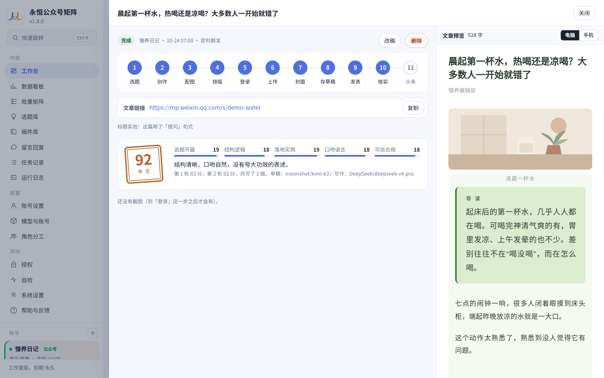
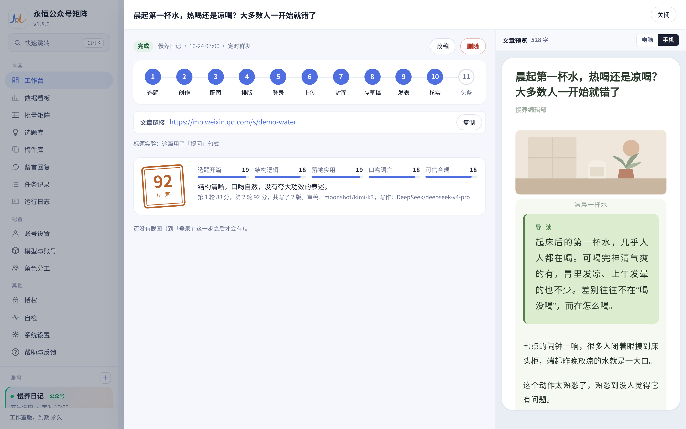
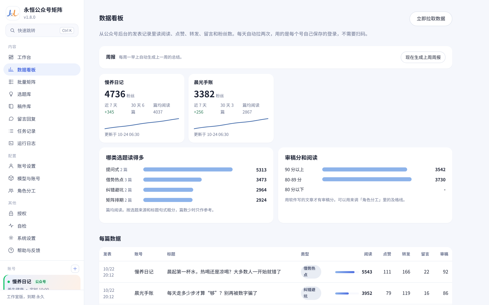
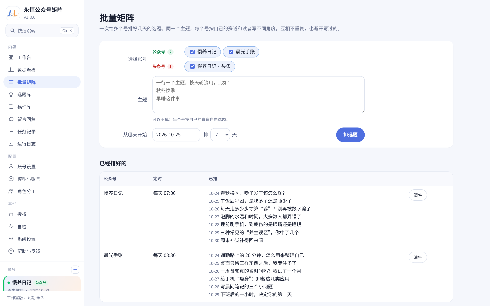
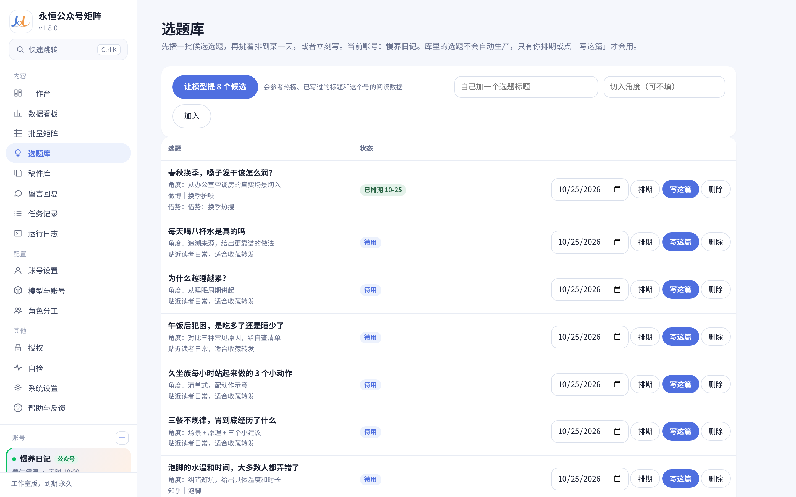
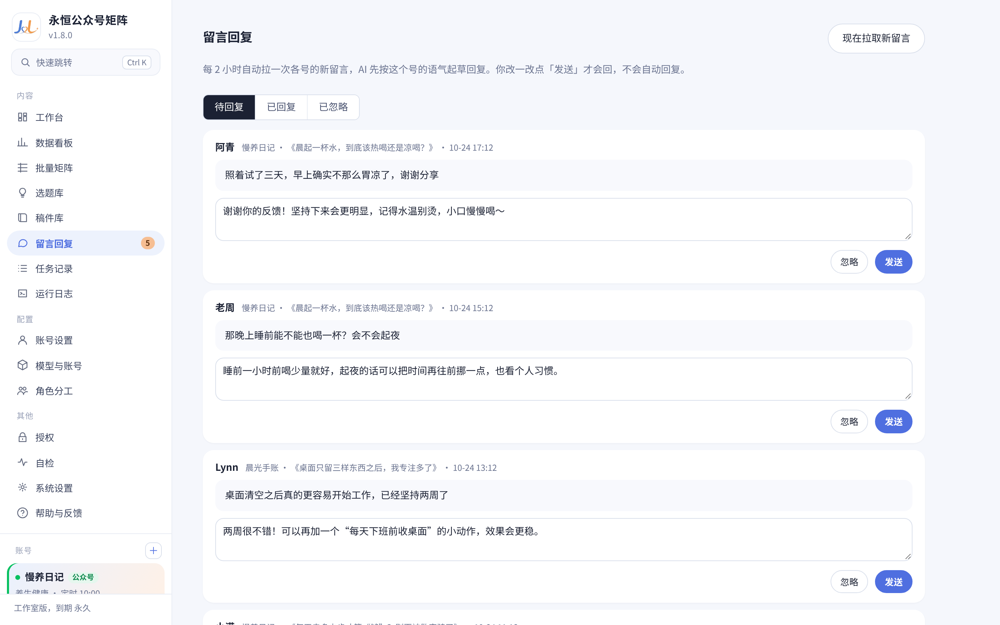
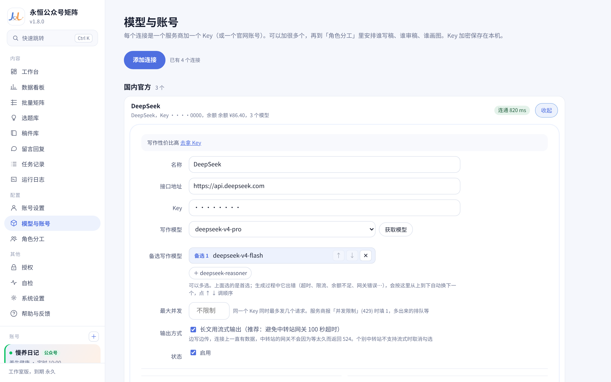

# ⚡ 永恒公众号矩阵 · 全自动自媒体生产力工作台

<div align="center">

<br>

[-0078D6?style=for-the-badge&logo=windows&logoColor=white)](https://github.com/ygwbl/wechat-mp-automator/releases/latest)
[](https://github.com/ygwbl/wechat-mp-automator/releases/latest)
[](https://github.com/ygwbl/wechat-mp-automator/releases/latest)
[](https://github.com/ygwbl/wechat-mp-automator/releases/latest)

<br>

# 🚀 一个人，就是一支自媒体集团军！
### 每天两分钟，10个公众号全自动写稿、配图、排版并推送进草稿箱。
**告别找选题脱发、写正文卡壳、排版眼花、切号提心吊胆的旧时代。**

<br>

<p align="center">
  <a href="https://github.com/ygwbl/wechat-mp-automator/releases/latest">
    
  </a>
</p>

<p align="center">
  <b>🔥 真正免配置 · 零代码门槛 · 下载即用 · 各行各业全适配 · 矩阵独立指纹防封</b>
</p>

[ ⚡ 降维打击对比 ](#-为什么同行能轻松日更10篇--传统苦熬-vs-永恒矩阵) • [ 💎 核心黑科技 ](#-为什么你一定会爱上它核心黑科技) • [ 📸 真实实机演示 ](#-全流程实机运行演示) • [ 🎯 全行业适配场景 ](#-各行各业全适配它能为你做什么) • [ 🚀 三步极速上手 ](#-三步极速上手)

<br>

</div>

---

> ### 💭 想象一下这样的工作日常：
> 早上起床，泡杯咖啡的功夫，你的 5 个、10 个公众号今天的**爆款选题、深度长文、高清配图、杂志级排版**已经全自动完成，并且安安静静地躺在微信官方草稿箱里。  
> 你唯一要做的事，只是在手机「订阅号助手」上瞄一眼，**轻轻点一下「群发」**。  
> **从每天苦熬 3 小时，变成每天只需 10 秒钟。**

---

## 🥊 为什么同行能轻松日更10篇？—— 传统苦熬 VS 《永恒矩阵》

| 维度对比 | 😫 传统人工 / 简陋网页AI工具 | ⚡ 《永恒公众号矩阵》桌面工作台 |
| :--- | :--- | :--- |
| **上手门槛** | 报错频出，逼你装 Python、Node、配环境，劝退小白 | **【真正的 0 门槛】下载 EXE 双击打开就用，比装微信还简单！** |
| **多号管理** | 手机反复扫码切号，IP/设备指纹关联导致批量封号 | **【物理级防关联】每个号独立沙箱与指纹环境，互不干扰，稳健保号** |
| **文章排版** | 手动找图排版 2 小时，排出来还是千篇一律的白底粗糙文 | **【专业杂志级审美】新中式水墨、科技极简、清单手账等高颜值排版** |
| **内容合规** | 一不留神踩中《广告法》违禁词或夸大宣传，文章被删限流 | **【全行业合规雷达】实时比对最新规范，自动拦截极限词与虚假宣传** |
| **模型稳定** | 依赖单一接口，一到晚高峰就超时崩盘，生产线彻底瘫痪 | **【双核模型网关】主力与备用接口智能秒级热切换，生产永不断线** |
| **生产效率** | 写一篇、排一篇、发一篇，半天时间全浪费在琐事上 | **【批量自动化流水线】一键指派、定时排期，多账号批量全自动搞定** |

---

## 💎 为什么你一定会爱上它？核心黑科技

### 1️⃣ 零依赖！零配置！真正的开箱即用 🛠️
* 彻底抛弃那些让人头皮发麻的编程终端、环境配置和代码报错！
* 专为创作者打造的 Windows 原生桌面软件，**解压/安装后双击就能直接跑**，电脑小白也能 3 分钟玩转。

### 2️⃣ 矩阵多开神盾：每个账号独立指纹隔离 🛡️
* 矩阵操盘手最怕什么？**账号关联，一封封一串！**
* 《永恒矩阵》为每一个绑定的公众号开辟**专属存储沙箱与独立指纹浏览器环境**，Cookie 与登录态物理级隔离，彻底告别频繁切号与封号噩梦。

### 3️⃣ 不只是写字，而是「十步工业级爆文流水线」 ⚙️
不是普通的聊天机器人一问一答，而是严格模拟顶尖自媒体团队的完整工序：
```
[选题发掘] ➔ [结构大纲] ➔ [正文精作] ➔ [深度去AI味降重] ➔ [广告法合规过滤]
   ➔ [专家多维审稿打分] ➔ [自适应配图生成] ➔ [艺术级排版渲染] ➔ [直推手机草稿箱]
```

### 4️⃣ 各行各业全适配，排版审美降维打击 🎨
拒绝粗制滥造的廉价排版！软件内置自媒体资深排版师调校的多套高级视觉方案：
* 🌿 **新中式水墨风**：水墨晕染、宣纸留白、淡彩点缀，中式美学天花板；
* 💼 **现代杂志风**：卡片导读、双色撞色、大号章节标、高级视觉留白；
* 📋 **清单笔记风**：重点荧光笔高亮、色块编号、勾选清单，高收藏率首选；
* 💡 **极简科技风**：干练边条、数据图表框、等宽标签，商业深度首选。

### 5️⃣ 全行业合规雷达，守护账号生命线 🚨
不管是做科技、商业、职场、教育，还是本地生活、文史科普、健康养生：
* 实时严查《广告法》最新严禁的绝对化用语（如国家级、最高级、独家、极速根治等）；
* 自动标记与重写违规词汇，将违规降权风险扼杀在发稿之前！

---

## 🎯 各行各业全适配，它能为你做什么？

无论你深耕哪一个赛道，《永恒矩阵》都能成为你不可或缺的超级助理：

* 📈 **商业 / 科技 / 职场**：快速拆解行业动态与热点趋势，输出逻辑缜密、结构严谨的干货深度长文；
* 🎓 **教育培训 / 知识博主**：知识点分步拆解、卡片式要点归纳，条理清晰，用户读得爽、乐意转；
* 🛍️ **本地生活 / 探店美食**：清单打卡式排版，色彩清新明亮，轻松打造高赞高收藏笔记；
* ☕ **文化历史 / 文艺故事**：水墨意境、诗意排版与金句留白，排版质感直接拉满；
* 💰 **多账号流量主矩阵**：多赛道并行日更，一人轻松打理 5~20 个账号，矩阵化躺赚流量收益。

---

## 📸 全流程实机运行演示

### 🖥️ 1. 一体化多账号工作台（一目了然，一键生产）
> 告别乱糟糟的浏览器标签页，名下所有公众号状态一目了然，支持批量一键生产！
<p align="center">
  
</p>

---

### 📝 2. 文章详情 · 智能审稿打分与合规过滤
> 像主编一样严格审查：AI 对正文进行多维度打分，合规漏洞一键清零！
<p align="center">
  
</p>

---

### 📱 3. 真实移动端所见即所得预览
> 真正的手机屏幕比例自适应预览，排版精细到每一个字间距和留白！
<p align="center">
  
</p>

---

### 📊 4. 深度数据看板 · 洞察每一个阅读峰值
> 自动统计各账号的粉丝与阅读增长，哪篇是爆款一目了然，用数据指导复利生产！
<p align="center">
  
</p>

---

### 🗓️ 5. 多账号排期日历 · 真正的自动化甩手掌柜
> 自定义每个账号的更新频率与发文时刻，自动错峰安排，井井有条。
<p align="center">
  
</p>

---

### 💡 6. 爆款选题灵感库 · 灵感永不枯竭
> 内置海量高热度爆款主题，点一下直接指派给账号全自动扩写！
<p align="center">
  
</p>

---

### 💬 7. 粉丝互动留言 AI 智能起草
> 自动同步读者评论，AI 结合人设秒回高情商互动内容，粉丝粘性蹭蹭涨！
<p align="center">
  
</p>

---

### ⚡ 8. 智能模型网关 · 备选模型无感秒切
> 主备双通道容灾，遇堵自动切换备选模型，生产永不卡壳！
<p align="center">
  
</p>

---

### 🛡️ 9. 独立指纹环境设置 · 矩阵号主的定海神针
> 真正的物理隔离环境，每个账号拥有专属沙箱与指纹，多开绝不串号！
<p align="center">
  
</p>

---

## 🚀 三步极速上手

```
┌─────────────────┐      ┌─────────────────┐      ┌─────────────────┐
│   1. 下载安装    │ ───> │   2. 扫码绑定   │ ───> │   3. 一键生产   │
│ 双击安装包即刻完成 │      │ 独立环境安全添加 │      │ 自动推送手机草稿箱 │
└─────────────────┘      └─────────────────┘      └─────────────────┘
```

1. **一键安装**：下载安装程序后直接双击运行，桌面将自动创建快捷方式；
2. **安全扫码**：在软件内打开「账号设置」，扫码登录你的微信公众号；
3. **享受全自动**：输入想要写的主题或直接选用灵感库选题，点击生产，手机打开草稿箱直接确认发表！

---

## ❓ 常见问题 (FAQ)

<details>
<summary><b>Q1: 我完全不懂技术、不会敲代码，真的能用吗？</b></summary>
<b>答：</b>请放 100 个心！本软件是专为自媒体人打造的**傻瓜式 Windows 原生桌面软件**。所有操作都有清晰的可视化按钮，不需要安装任何代码运行环境，双击打开就像用日常软件一样简单。
</details>

<details>
<summary><b>Q2: 生成的文章排版为什么这么好看？会不会千篇一律？</b></summary>
<b>答：</b>软件彻底摒弃了普通工具生硬单调的 Markdown 转换，而是通过独立研发的渲染引擎，根据你的文章内容自适应匹配水墨、杂志、手账等排版风格，段落金句、卡片框、重点标注一应俱全，篇篇都是杂志级排版！
</details>

<details>
<summary><b>Q3: 多账号登录真的不会关联封号吗？</b></summary>
<b>答：</b>绝不会。《永恒矩阵》底层采用了顶级的浏览器沙箱与独立指纹隔离技术，每个账号的 Cookie、存储数据和浏览器指纹均完全物理隔离，效果等同于在多台独立电脑上运行。
</details>

<details>
<summary><b>Q4: 可以免费体验吗？如何获取？</b></summary>
<b>答：</b>当然可以！直接在 Releases 下载最新安装包即可上手体验。如需开启无限制多账号矩阵、无限次生成配额与专属词库更新，请在软件内的「授权管理」中联系我们开通专属卡密。
</details>

---

<div align="center">

<br>

## 🌟 别再把时间浪费在低效内耗上！
### 拥有《永恒公众号矩阵》，立即开启你的全自动自媒体矩阵时代！

<br>

<p align="center">
  <a href="https://github.com/ygwbl/wechat-mp-automator/releases/latest">
    
  </a>
</p>

<br>

**如果这个项目为你节约了时间，请在右上角点亮一个 ⭐️ Star 鼓励我们！**

[](https://github.com/ygwbl/wechat-mp-automator)

<br>

</div>
