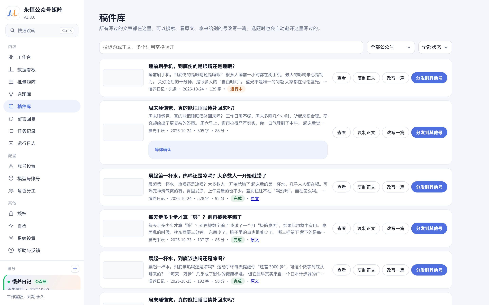
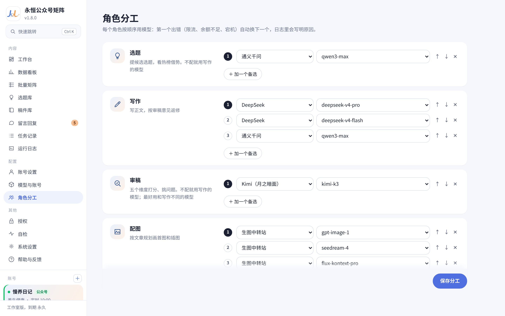

# 🚀 永恒公众号矩阵 · 智能自媒体运营工作台

  <b>专为公众号流量主、自媒体工作室及个人创作者打造的 Windows 桌面级智能运营客户端</b> 
  <b>无需复杂配置 · 零代码门槛 · 多账号独立环境防封 · AI全流程自动写稿配图 · 一键推送到草稿箱</b>

[📥 立即下载最新版 (v1.8.6)](https://github.com/ygwbl/wechat-mp-automator/releases/latest) • [✨ 核心功能](#-核心功能亮点) • [📸 界面截图](#-软件界面实测展示) • [❓ 常见问题](#-常见问题-faq)

---

## 💡 为什么选择《永恒公众号矩阵》？

市面上大多数 AI 工具要么是网页套壳、排版千篇一律，要么是需要自备环境、配置复杂的命令行脚本，对普通创作者极其不友好。

**《永恒公众号矩阵》打破门槛，彻底实现桌面客户端「开箱即用」：**

* 🟢 **真正的开箱即用**：无需安装 Node.js、Python 或任何数据库，下载 EXE 双击安装即可使用。
* 🛡️ **多账号独立环境防封**：每个公众号拥有专属独立的浏览器指纹环境与 Cookie 隔离，免除频繁切号被封风险。
* 🎨 **高颜值自动排版引擎**：内置新中式水墨风、莫兰迪杂志风、清单手账等爆款视觉风格，自动配图与排版。
* 📝 **智能审稿与广告法合规拦截**：专为养生、健康、生活、情感等赛道设计，严格拦截违禁词与夸大医疗功效，安全保号。
* 📲 **一键直达手机草稿箱**：自动生成后推送到微信官方草稿箱，手机「订阅号助手」一键直接发布。

---

## 📸 软件界面实测展示

### 1. 多账号总览与一键全自动生产
> 一站式看板管理名下所有公众号，一键批量触发多账号写作与发布任务。

---

### 2. 任务详情 · 文章预览与多维度智能审稿打分
> 严格的十步流水线，AI 自动完成正文撰写、查重降重、广告法合规性检查并给出专业评分。

---

### 3. 真实移动端排版效果预览
> 告别传统生硬单调排版！所见即所得的手机端自适应预览，美观大方，极大提升完读率与转化。

---

### 4. 数据看板 · 粉丝与阅读转化深度分析
> 实时汇总各账号阅读量、点赞量、粉丝净增走势，为下一次选题策略提供数据支撑。

---

### 5. 批量矩阵 · 多账号自动化排期日历
> 支持自定义发布节奏，不同赛道、不同账号独立定时错峰发布，真正的全自动化运转。

---

### 6. 爆款选题库 · 告别选题焦虑
> 汇聚全网自媒体高热度爆款主题与赛道灵感，一键指派给指定公众号进行全自动扩写。

---

### 7. 稿件资产库 · 沉淀你的数字资产
> 历史稿件、草稿与发布记录分门别类归档，方便随时回溯与二次创作。

---

### 8. 粉丝留言 AI 智能起草回复
> 自动同步文章最新读者留言，AI 结合人设智能生成高情商回复草稿，提升粉丝粘性。

---

### 9. 智能模型网关 · 备选模型无缝热切换
> 支持接入各大主流大模型（DeepSeek、Claude、OpenAI、DashScope 等），内置主备自动降级切换与容灾策略，保证流水线永不断线。

---

### 10. 角色链路分工 · 模块化协同生产
> 支持将“选题构思、草稿起草、视觉设计、审校打分”分配给不同模型分工协作，生产质量大幅超越单一提示词。

---

### 11. 独立指纹环境设置 · 安全防关联
> 每一个绑定的公众号后台均在物理隔离的专用环境内运行，支持独立代理与指纹配置，彻底解决多账号封号痛点。

---

## 📥 下载与安装

### 系统要求
* **操作系统**：Windows 10 / Windows 11 (64位)
* **环境依赖**：**无需配置任何运行环境**，系统自带 WebView2 / Edge 即可运行。

### 获取最新版
👉 点击前往 **[GitHub Releases 页面](https://github.com/ygwbl/wechat-mp-automator/releases/latest)** 下载最新安装程序：
* `永恒矩阵-安装-v1.8.6.exe` (一键安装版)

---

## 🚀 三步快速上手

1. **下载安装**：下载后双击运行安装包，桌面将自动生成《永恒矩阵》启动快捷方式；
2. **添加账号**：在「账号设置」中扫码登录你的微信公众号（支持多账号）；
3. **开始生产**：在「工作台」点击一键生产或选择选题，系统将自动撰写、排版、配图并推送到手机草稿箱！

---

## ❓ 常见问题 (FAQ)

<b>Q1: 我是电脑小白，完全不懂代码，可以使用吗？</b>

A: 完全可以！本软件专门针对自媒体创作者设计为图形化客户端（EXE），无需安装 Node.js、Python 或输入任何命令行，所有操作均通过鼠标点击完成。

<b>Q2: 多个公众号在同一台电脑上登录会关联封号吗？</b>

A: 不会。《永恒矩阵》底层针对每个账号分配了独立的存储沙箱和专属指纹浏览器环境，Cookie 与会话物理隔离，与日常多台电脑登录效果一致。

<b>Q3: 为什么生成的文章排版比普通的 AI 工具好看得多？</b>

A: 本软件内置了专业的新媒体视觉排版引擎，并非简单的 Markdown 纯文本转换，而是采用模块化卡片、自适应配图、色彩呼应与移动端阅读体验优化方案。

<b>Q4: 如何获取软件试用与正版授权？</b>

A: 下载安装后可直接获取基础体验权限。如需开通多账号矩阵、无限次生成及专属爆款词库，请在软件内「授权管理」或通过主页联系我们获取授权码。

---

**永恒公众号矩阵 · 让每一次创作都省心省力**  
如果这个项目对你有帮助，欢迎在右上角点亮一个 ⭐️ **Star** 支持我们！

